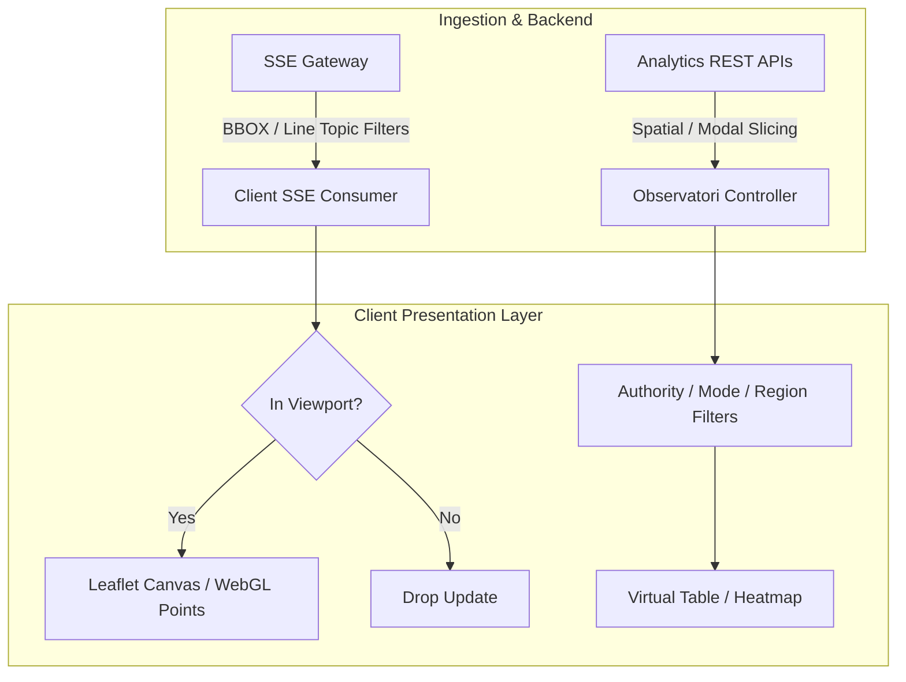

# Technical Review: Frontend & Observatori Architecture at Catalonia Scale

**Scope**: Frontend architecture (`public/index.html`, `plan.html`, `dades.html`, `public/js/*`, `public/css/style.css`, `sw.js`, `manifest.webmanifest`) and UI Design System (`UI_GUIDE.md`).  
**Objective**: Scale Arribo! from Mataró Bus Urbà (8 lines, 155 stops, ~20 buses) to all public transport in Catalonia (>1,000 lines, >20,000 stops, >3,500 active vehicles across Rodalies, FGC, TMB Metro/Bus, TRAM, and regional buses), centering on punctuality tracking and the Observatori ("Dades").

---

## 1. Key Findings

### 1. Hard-Coded 8-Line Catalog, Fixed RegEx & Route Palette (Severity: BLOCKER)
* **Verified in Code**:
  * `public/js/app.js:484-508`: `defaultEmergencyLines` hardcodes Mataró lines `1` through `8` with static Avanza titles and colors.
  * `public/js/app.js:34, 163`: `lineCache = new Map()` enforces an LRU ceiling of exactly 8 routes (`this.lineCache.size >= 8`).
  * `public/js/networkMap.js:23-26`: `canonicalLineCode()` uses `/^L?(\d+)$/i`, stripping any line code containing letters. This silently eliminates Rodalies (`R1`–`R8`, `RG1`, `RT1`), FGC (`S1`, `S2`, `R5`, `L6`), TMB Metro (`L9N`, `L10S`, `FM`), TMB Bus (`H12`, `V15`, `D40`), TRAM (`T1`–`T6`), and interurban expresses (`e11.1`).
  * `public/js/app.js:5198-5205`: `refreshNetworkMap()` filters exclusively for `/^L?[1-8]$/i` and executes parallel un-batched `fetch('/api/line/${id}?direction=both')` calls. At Catalonia scale (1,000+ lines), this triggers 1,000 concurrent HTTP requests, crashing mobile viewports and triggering IP rate-limiters.
  * `public/css/style.css:474-489, 10606-10613, 10683-10686, 10970-10977`: Static CSS variables (`--line-1` to `--line-8`), dot indicators (`.line-dot-1..8`), chip classes (`.line-chip-1..8`), and GPS gap grids (`grid-template-columns: auto repeat(8, minmax(0, 1fr))`) are hardcoded for 8 routes.
  * `public/js/app.js:79-80, 961-963`: Trains and Rodalies lines are explicitly filtered out from the UI (`this.showTrainsInUI = false`).
* **Impact**: Zero non-numeric or non-Mataró lines can load, render on the landing map, or receive color tokens.

### 2. Monolithic Full-Fleet SSE Stream & Linear O(N) Processing (Severity: BLOCKER)
* **Verified in Code**:
  * `public/js/app.js:5327`: The client connects to an unpartitioned SSE stream `/api/fleet/events`.
  * `public/js/app.js:5387-5390`: On every tick, the client performs linear array filtering: `snapshot.vehicles.filter(matchesView)`.
* **Quantified Blast Radius (Inferred from scale invariants)**:
  * Today: ~20 buses produce ~10 KB JSON payload per tick.
  * Catalonia scale: 3,500 vehicles with coordinates, bearings, and delay badges produce ~1.5–2.0 MB uncompressed JSON per tick.
  * Pushing 2 MB every 15–20 seconds over SSE to hundreds of mobile devices consumes gigabytes of client bandwidth, triggers continuous V8 garbage-collection spikes, and blocks the main thread during `JSON.parse`.

### 3. Leaflet DOM-Marker Explosion & Hardcoded Bounding Coordinates (Severity: BLOCKER)
* **Verified in Code**:
  * `public/js/map.js:84`, `public/js/networkMap.js:50`: The map view is pinned to Mataró: `.setView([41.54, 2.44], 13)`.
  * `public/js/stopFeatures.js:75-78`: Geolocation strictly discards user coordinates outside Mataró (`lat 41.45–41.60`, `lon 2.35–2.52`), defaulting non-Mataró users to the Mataró zone picker.
  * `public/js/map.js:143-150`, `public/js/networkMap.js:30-33`: While `preferCanvas: true` is set for polylines, vehicles are instantiated as `L.marker` instances using `L.divIcon`, generating real HTML DOM tree nodes for every vehicle.
  * `public/js/app.js:5113-5121`: `stepBusAnimation` runs inside `requestAnimationFrame` at 60 FPS, calculating trigonometry and CSS transforms on every marker.
* **Impact**: Animating 3,500 active DOM elements at 60 FPS degrades frame rates to single digits (<10 FPS) and exhausts GPU memory on mobile devices.

### 4. Dades / Observatori Tab Architecture at Catalonia Scale (Severity: MAJOR)
* **Verified in Code** (`public/js/observatori.js:1275-1450, 2309, 2598, 3981-4030`):
  * **Current View & Endpoint Inventory**:
    1. *Historical delay report*: `/api/analytics/journalism?hours=24|48|168` (summary KPIs, `rankingMostDelayed`, `rankingWorstStops`, `allStopDelays`, `agencyStats`, stop heatmap).
    2. *Data Health*: `/api/data-health` (single feed checks, seasonal calendar drift).
    3. *GPS loss map ("On perden el GPS")*: `/api/analytics/gps-gaps?days=N&line=...` and `/api/analytics/gps-gaps/paths?ids=...`.
    4. *El Termòmetre*: `/api/analytics/termometre?hours=N` (scorecard, single municipal grade A–D, SVG infographic export).
    5. *Top Incidents & Forensic Drill-Down*: `/api/analytics/incidents?line=...` and `/api/analytics/incidents/inspect?line=...&stop=...&at=...&vehicle=...`.
    6. *Monthly Report*: `/api/analytics/report/monthly?month=YYYY-MM` (tailored exclusively for "Ajuntament de Mataró", L1–L8).
* **Impact & Risks**:
  * *Heatmap DOM explosion*: The 24-hour stop heatmap (`public/js/observatori.js:1127-1153`, `public/css/style.css:9-70`) renders an un-paginated 2D table. For 155 stops, this is 3,720 cells. For Catalonia's 20,000 stops, rendering 480,000 `<td>` elements crashes the browser tab.
  * *Single-agency metric collapse*: "El Termòmetre" awards a single global grade (`public/js/observatori.js:2346-2371`). Blending Rodalies, Metro, and local rural buses into a single composite score obscures acute corridor-level failures.
  * *Absence of territorial/modal filtering*: Navigation allows filtering only by line code (`public/js/observatori.js:1055-1061`) or text search (`public/js/observatori.js:999-1006`). There are no facets for Transport Authority (ATM Àrea de Barcelona, ATM Girona, ATM Camp de Tarragona, ATM Lleida), mode (Rodalies, Metro, Bus, FGC), or Municipality.

### 5. Hardcoded Municipal API Endpoints & Assumptions (Severity: MAJOR)
* **Verified in Code**:
  * `public/js/plan.js:651`: Journey planner hardcodes `/api/mataro/plan?...`.
  * `public/js/app.js:1093`: Favorite stop departures query `/api/mataro/stop/${stopId}/departures`.
  * `public/js/stopFeatures.js:134`: Nearby stops query `/api/mataro/stops/nearby?...`.
  * `public/js/stopFeatures.js:7-17`: `MATARO_ZONES` hardcodes 9 fixed Mataró landmarks.
* **Impact**: Subsystems bypass generic multi-agency backends, failing silently whenever non-Mataró stop identifiers are requested.

### 6. Service Worker Storage Bounds & Missing i18n Dictionary (Severity: MINOR)
* **Verified in Code**:
  * `public/sw.js:2, 36`: Cache name `arribo-mataro-cache-v94` enforces an eviction limit of **32 entries** (`keys.slice(0, Math.max(0, keys.length - 32))`). In a Catalonia-wide search catalog, searching 33 towns flushes previously cached route topologies.
  * `public/index.html:2`, `public/plan.html:2`, `public/dades.html:2`: UI is statically hardcoded in Catalan (`lang="ca"`), with only an isolated modal snippet supporting Spanish (`public/js/app.js:376-379`). There is no structured localization dictionary for English/Spanish regional commuters.

---

## 2. Recommended Changes

### Priority 1: Dynamic Line Model & Modal Architecture (Effort: M)
1. **Dynamic Color Engine**: Remove static CSS line tokens (`public/css/style.css:474-489`). Adopt the luminance algorithm in `public/js/utils.js:59-74` to dynamically calculate contrast on runtime GTFS `route_color` / `route_text_color`.
2. **Canonical Line Code Generalization**: Replace `/^L?(\d+)$/i` in `public/js/networkMap.js:23` with a composite regex matching all Catalan transit modes: `/^(L\d+|R\d+[A-Za-z]*|RG\d+|RT\d+|S\d+|T\d+|V\d+|H\d+|D\d+|e\d+(\.\d+)?|\d+[A-Za-z]?)$/i`.
3. **Line Cache Scaling**: Increase `this.lineCache` capacity from 8 to 64 (`public/js/app.js:34, 163`) and scope cache keys by `agencyId_lineId_direction`.
4. **Endpoint Path Normalization**: Unify `/api/mataro/*` references across `public/js/plan.js:651`, `public/js/app.js:1093`, and `public/js/stopFeatures.js:134` to `/api/v1/*`.

### Priority 2: High-Density Map Rendering & Viewport Culling (Effort: L)
1. **Canvas / WebGL Point Rendering**: Discontinue DOM-based `L.marker` / `L.divIcon` for network vehicle rendering (`public/js/map.js:143`, `public/js/networkMap.js:30`). Render fleet positions using Leaflet's HTML5 Canvas renderer (`L.CircleMarker` with custom canvas drawing pass) or integrate MapLibre GL / Pixi.js overlays.
2. **Dynamic BBOX Initialization**: Replace `setView([41.54, 2.44], 13)` (`public/js/map.js:84`) with browser geolocation checking Catalonia's bounding box (`lat 40.5–42.9`, `lon 0.15–3.35`), falling back to the user's selected municipality or Catalonia overall (`[41.59, 1.83]`, zoom 8).
3. **Network Map Fetch Bundling**: Deprecate per-line `fetch('/api/line/${id}')` looping (`public/js/app.js:5205`). Replace with a single aggregated endpoint `/api/lines/topology?agency=...` or tile-based PBF vector shapes.

### Priority 3: Scoped Real-Time SSE Streaming (Effort: M)
1. **Parametric SSE Channels**: Update `EventSource('/api/fleet/events')` (`public/js/app.js:5327`) to accept filtering query parameters: `/api/fleet/events?bbox=minLon,minLat,maxLon,maxLat` or `/api/fleet/events?lineId=...`.
2. **Delta Encoding**: Stream only changed positions (vehicle ID, lat, lon, delay, bearing) rather than complete vehicle objects.

### Priority 4: Evolution of the Observatori ("Dades") Tab (Effort: L)
1. **Hierarchical Filtering**:
   * Add a top-level filter toolbar (`public/dades.html:90`): `ATM (Territory) → Mode (Rodalies, FGC, Metro, Bus) → Operator (Renfe, TMB, Moventis...) → Line`.
2. **Virtualization of Heatmaps & Tables**:
   * Wrap `.stop-heatmap` (`public/css/style.css:9-70`) and incident tables in a virtual scroll viewport (rendering only the 30 rows in view). Restrict heatmap queries to a single line corridor or top 50 bottlenecks rather than the entire regional catalog.
3. **Corridor-Based Incident Grouping (Rodalies Timelines)**:
   * Evolve the incident drilldown (`public/js/observatori.js:2646-2705`) from single-bus/stop analysis into infrastructure corridor disruption timelines (e.g., aggregating incidents across the Arc de Triomf–Clot tunnel or R1 Maresme coastal corridor).
4. **Comparative Operator League Tables**:
   * Expand `agencyStats` (`public/js/observatori.js:1385`) into a dedicated operator benchmark view ranking punctuality, reliability, and telemetry freshness.
5. **Multi-Territorial "El Termòmetre"**:
   * Parameterize `/api/analytics/termometre` (`public/js/observatori.js:2309`) with `?scope=rodalies`, `?scope=tmb-metro`, or `?agency=...`, outputting modal-specific grades and SVG infographics.

---

## 3. Quick-Win Optimizations

1. **Stop Search Debounce & Bounding**: Lower search debounce from 200 ms to 150 ms, add minimum 2-character query length (`public/js/app.js:717-744`), and append BBOX hints (`?nearLat=...&nearLon=...`) so local stops rank before regional namesakes.
2. **Punctuality Heatmap Pagination**: Clamp initial heatmap rendering (`public/js/observatori.js:1367`) to top 25 slowest stops with an explicit "Carregar més" trigger to avoid DOM locks.
3. **Service Worker Cache Expansion**: Increase API response cache limit from 32 to 128 entries in `public/sw.js:36`.
4. **Remove Rodalies UI Suppression**: Flip `this.showTrainsInUI = true` in `public/js/app.js:80` and delete the train filter in `public/js/app.js:962` to immediately display train data already processed by the backend.
5. **URL Deep-Linking for Incidents**: Read incident ID on load (`public/js/observatori.js:64-111`) via `?incident=ID` to automatically open the forensic drill-down panel for shared reports.

---

## 4. Open Questions & Architectural Risks

1. **Provider Data Heterogeneity**: Avanza Mataró provides SIRI delays directly. Other operators (Rodalies/Renfe, TMB, regional buses) often publish GTFS-RT (TripUpdates + VehiclePositions) or proprietary feeds with disparate punctuality definitions. Can the frontend maintain its strict punctuality contract (`-1 to +3 min` on-time, `anomalies.go`) across operators without bespoke client adapters?
2. **Map Tile CDN & Carto License**: `public/js/observatori.js:323-326` uses a hard-coded Carto basemap API key (`cb1_2e4m_1_...`). At Catalonia-wide traffic volumes, this public client key will face quota exhaustion or domain restrictions.
3. **Mobile Memory Budget**: On low-end mobile devices, retaining multi-operator GTFS schedules and Leaflet canvas polylines concurrently with forensic incident trajectories may exceed 100 MB client heap limits, triggering background tab termination.
